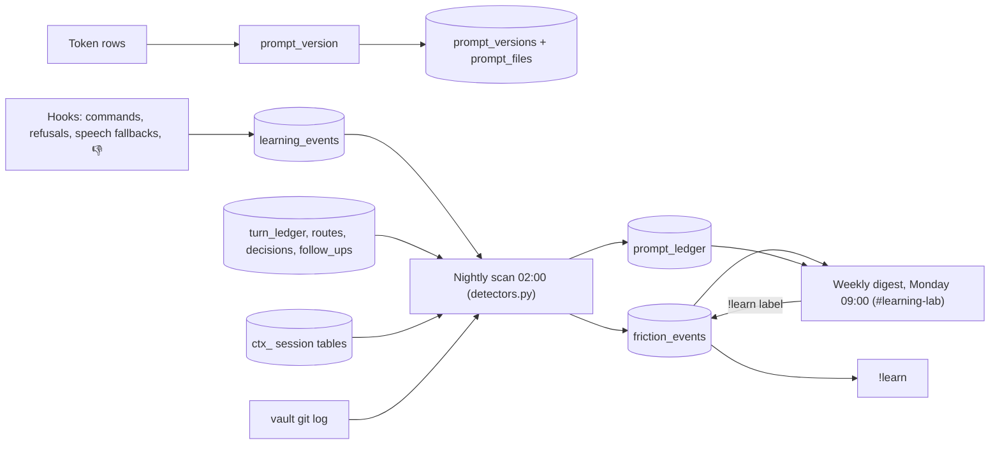

# Self-Learning Loop

`core/learning` is how the team finds out where working with it costs you
extra turns, waiting, or repeating yourself, and later, how it tests small
prompt changes that remove that cost. The design is in the self-learning
proposal: find **friction**, propose a small diff to the prompt that causes
it, prove the diff with a replay and your votes, then keep or revert it.

**Phase 0 observes; Phase 1 proposes.** No agent's prompt, tools or behaviour
change. The loop logs what no other table keeps, records which prompt each
model call ran on, scans memory.db every night for friction, and reports
weekly in `#learning-lab`. There, the analyst, Kaizen 🪞 (`agents/agent-learner/`),
traces recurring friction to the prompt text that causes it and hands in
proposals, which code checks and saves; none is applied yet (Proposals, below).
It has **one switch**, `LEARNING_OBSERVE` (`core/config/settings.py`):

| `LEARNING_OBSERVE` | What happens |
|---|---|
| on (default) | The hooks log commands, refused actions, voice replies without `<speech>`, and your 👎. Token rows keep the prompt version. The nightly scan and the weekly digest run. |
| off | None of it runs. Token rows get no prompt version. |

> [!IMPORTANT]
> Nothing here runs before a reply is out, and nothing can fail a turn. Hooks
> queue their write on one worker thread (`events.py`, like the Board's) and
> never raise. The prompt version is cached and re-checked by file size and
> mtime at most every 30 s. The scan runs at 02:00 as a script.

## Flow



1. **Observe.** The runtime's hooks write `learning_events` rows (below).
   `LoggingHandler` puts the agent's prompt version on every token row
   (`versions.py`).
2. **Detect.** `scripts/learning_nightly.py` runs every detector over the last
   three days. A day read twice adds nothing twice: a card's key is
   (detector, source, source_id). It records one `learning_runs` row, and
   snapshots each agent's prompt size (`ledger.py`).
3. **Report.** `scripts/learning_digest.py` posts the week in `#learning-lab`
   on Mondays: the frictions, the recurring patterns, a few cards to label,
   each detector's precision, and the ledger's alerts. `!learn` shows the same
   on demand.
4. **Label.** You mark cards real or not (`!learn label 412 418 real`). Labels
   measure each detector's precision. A detector below 0.5 after 20 labels is
   muted until its rule is fixed.

## Files

| File | What it does |
|---|---|
| `events.py` | The hooks' writes, on one worker thread. `record_command`, `record_refusal`, `record_speech_fallback`, `record_reaction` |
| `versions.py` | `current(agent_id)`: the prompt version `<static8>.<memory8>`. Records each new version and the text of its repo files |
| `detectors.py` | The friction detectors: deterministic rules over rows, with no model. `scan()` runs them all |
| `thresholds.py` | Every number the detectors use, in one place, to tune from your labels |
| `ledger.py` | The daily prompt-size snapshot per agent |
| `report.py` | Every text `!learn` and the digest show |
| `boundaries.py` | What the analyst may hold, read and propose: the lethal-trifecta rule, in code |
| `digests.py` | A card's episode, cut and clipped by code, for the analyst |
| `proposals.py` | `submit()`: refuses what isn't a proposal, runs the checks, saves it |
| `gates.py` | The nine static checks on a proposal |
| `protected.py` | The behaviours a proposal may never weaken |
| `core/storage/learning.py` | `LearningStore`: the tables below, plus the SELECT-only reads of other stores' tables that the detectors make |
| `core/runtime/commands/typed/learn.py` | `!learn` |
| `scripts/learning_nightly.py`, `scripts/learning_digest.py` | The two schedules (`agents/script-executor/agent.json`) |

**Tables** (`core/storage/schemas/learning.sql`, in memory.db): `friction_events`,
`learning_events`, `prompt_versions`, `prompt_files`, `prompt_ledger`,
`learning_runs`, `proposals`. Token rows in the `ctx_` tables gain a `prompt_version` column.

## The hooks

| Hook | Where | What it logs |
|---|---|---|
| Command log | `CommandRegistry.answer` | Every command that answered: typed (`!kill`, `!new`…), spoken ("stop", "go back"…) or control. The agent and channel are read *before* it runs, since "go back" moves the voice room |
| Refusals | `ToolsLoader.check_permission` | An action the agent's grants refused. A probe (`probe=True`) or a check without an action (prompt building, the tool-level gate) isn't a refusal |
| Speech fallbacks | `core/channel/voice/speech/reply.py` | A voice reply that came without `<speech>`, so its fallback was spoken |
| 👎 | `BotRunner.on_raw_reaction_add` | A person's 👎 on a bot's own message. It is logged once: by the bot that posted it, where this instance owns its agent |

## The detectors

A **card** is one friction a detector found: what was seen (`evidence`, never a
model's paraphrase), whose words those are (`evidence_role`), a severity
(1 cosmetic · 2 an extra turn or 30 s · 3 a failed task or a wrong action),
and what it cost when code can count it. "Your turns" are `turn_ledger` rows
with `caller = 'main'`, not scheduled, on a text or voice surface, and not
another agent's call.

| Detector | Source | Rule |
|---|---|---|
| `correction` | turn_ledger | Your next turn in the same session, ≤10 min later, starts with or contains a correction ("no", "I said", "you forgot"…). A bare "no" answering the reply's question isn't one. "I told you" marks `ignored_instruction` |
| `rephrase` | turn_ledger | Your next turn, ≤10 min later, reads ≥0.6 alike (difflib on normalised text), both ≥4 words |
| `abandoned_question` | turn_ledger | The reply ended with a real question (not an offer like "want me to…?"), and you didn't answer in that session for 24 h, though you talked elsewhere |
| `agent_switch` | turn_ledger | You asked another agent the same thing (≥0.6 alike) within 30 min |
| `contract_break` | turn_ledger, decisions, learning_events | Markup (`<speech>`, `<poll>`…) in the reply you saw; a Switchboard run that failed; a speech fallback |
| `tool_failure` | ctx_ `Tool Output` rows | `tool_status()` is failed or partial; the evidence is the first error line |
| `tool_loop` | ctx_ `Tool <name>` rows | The same call twice or more in one turn |
| `round_trips` | ctx_ token rows | More model calls in one turn than the surface's budget (voice 3, text 6) |
| `voice_cutoff` | ctx_ turn_trace rows | The turn ended `cancelled` (barge-in), `stop_cancel` ("stop") or `stt_failed` |
| `slow_turn` | ctx_ turn_trace rows | Time to first audio above 1.5 × the agent's 30-day p90, once it has 20 traces |
| `refusal` | learning_events | A refused action. Severity 2 when the same agent and tool were refused within 2 min: it retried |
| `misroute` | routes, learning_events | A route you labeled "wrong agent"; a spoken "go back" |
| `explicit_label` | routes, learning_events | Your ❌ on a route; a proactive post you declined or ignored; your 👎 |
| `interrupt` | learning_events | `!kill` |
| `unmet_follow_up` | follow_ups | One you cancelled within a day of opening it, or a watch that ran to its end and found nothing |
| `post_edit` | turn_ledger + the vault's git log | A commit by someone other than the host's vault identity (`git config user.email`) changed ≥3 lines of a file an agent wrote, within 48 h. Silent when every vault commit is the host's |

Every number is in `thresholds.py`. Evidence is scrubbed of secret-shaped
strings before it's stored (`detectors.scrub`).

**What Phase 0 doesn't read:** `archive.db`. A session archived before the
bot's last restart has moved there, so a scan reads only what memory.db still
holds. The nightly run reads three days, well inside that.

## Patterns and the exit criteria

A **pattern** is one agent's cards from one detector (`report.patterns`). It
**recurs** once it has ≥3 cards in ≥2 sessions within 14 days, or at once for a
correction that says you'd told the agent before. Recurring patterns are
what the analyst works on.

Phase 0 ends when the detectors can be trusted:
- ≥50 labeled cards at ≥0.7 precision;
- ≥5 recurring patterns.

`!learn` and the digest show where both stand.

## The prompt ledger

`ledger.py` measures each agent's prompt once a night: persona, preloaded
skills, USER.md, shared memory (Profile and topics), MEMORY, FEEDBACK, and a
count of instruction-like lines. Everything is measured as the prompt builder
loads it. `!learn ledger` shows the change over 30 days. It flags growth past
10% in a month, and any drop of a quarter from one night to the next: a
rewrite that lost text is the failure the proposal's §10 warns about.

## Proposals (Phase 1)

Kaizen 🪞 (`agents/agent-learner/`, home `#learning-lab`) reads the friction
through one tool, `friction_query`: patterns, cards, and a card's episode as
`digests.py` cuts it. It never reads memory.db itself, and never edits a file.
Mondays at 10:00, when a recurring pattern has no proposal yet, it reviews up to
three (`skills/friction_review/`) and hands in a change for each whose cause is
prompt text (`skills/prompt_experiment/`), with `submit_proposal`:

1. **Refused** outright, with nothing saved: no edits, no rationale, unknown
   cards, the same change twice, or a fourth pattern (or candidate) this week.
2. **Checked** by code (`gates.py`): where it may land, that each edit applies,
   size, budget, protected behaviours, new wiring, personal information
   outside pkm/, that the file still loads, and agent_lint. The reasons go back
   to Kaizen, which revises or drops it.
3. **Saved** as `checked` or `failed` in `proposals`. `!learn proposals` lists
   them; nothing is applied.

**Boundaries** (`boundaries.py`, tested over its agent.json): it holds
`friction_query`, `submit_proposal`, a read-only `filesystem` and `load_skill`,
nothing else; it lives in `#learning-lab`; no follow-ups, and its conversations
stay out of the proactive team (`"taps": false`). A deny key refuses even the
write every agent gets on its own vault folder, so its FEEDBACK and MEMORY
change only through the nightly dream, like everyone's. It may propose to an
agent's AGENTS.md or SOUL.md, a skill's SKILL.md, a template, or an agent's
RULES.md or FEEDBACK.md in pkm; never code, config, its own files, or this
folder, which it can't even read.

Next steps: the replay and your votes (1b), then Aki applying what you approve (1c).

## `!learn`

```
!learn                         the last 7 days: frictions by detector and agent, the worst 5,
                               the last scan, Phase 0's exit criteria
!learn friction [agent]        the last 14 days' patterns, recurring first, with quotes
!learn cards [n]               cards to label, taken in turn from each detector
!learn label <id>… real|not    your verdict on cards
!learn ledger                  each agent's prompt size and its change over 30 days
!learn proposals [id]          what Kaizen handed in, and what the checks found
```

Any channel's host answers it, `#learning-lab` included.

## Security and privacy

- Cards and events stay in memory.db (under `sessions/`, never in the repo).
  Tests use invented text.
- The digest quotes your words from any channel into `#learning-lab`, in the
  same Discord server. Keep that channel private.
- Nothing here calls a model, the network, or another agent. Kaizen calls a
  model; it can't send anything anywhere (`boundaries.py`).
- A proposal for a repo file may carry nothing personal: the repo is public
  (`gates.py`, the personal check). A lesson that needs a personal detail goes
  to the agent's FEEDBACK.md or RULES.md in pkm.

## Tests

- `tests/core/learning/`: every detector on fixture rows and the whole scan (`test_detectors.py`); the hooks (`test_events.py`); versions; the ledger; the report texts.
- `tests/core/storage/test_learning.py`: the store, and its reads of other stores' tables.
- `tests/core/runtime/commands/typed/test_learn.py`: `!learn`.
- `tests/scripts/test_learning_nightly.py`, `tests/scripts/test_learning_digest.py`: the two scripts.
- `tests/core/channel/voice/test_turn.py`: a voice reply without `<speech>` is logged.
- `tests/core/learning/test_boundaries.py`, `test_gates.py`, `test_proposals.py`, `test_digests.py`: the analyst's boundaries, each check, proposals, episodes.
- `tests/agents/agent_learner/`: Kaizen's tools, views and Monday scan.
