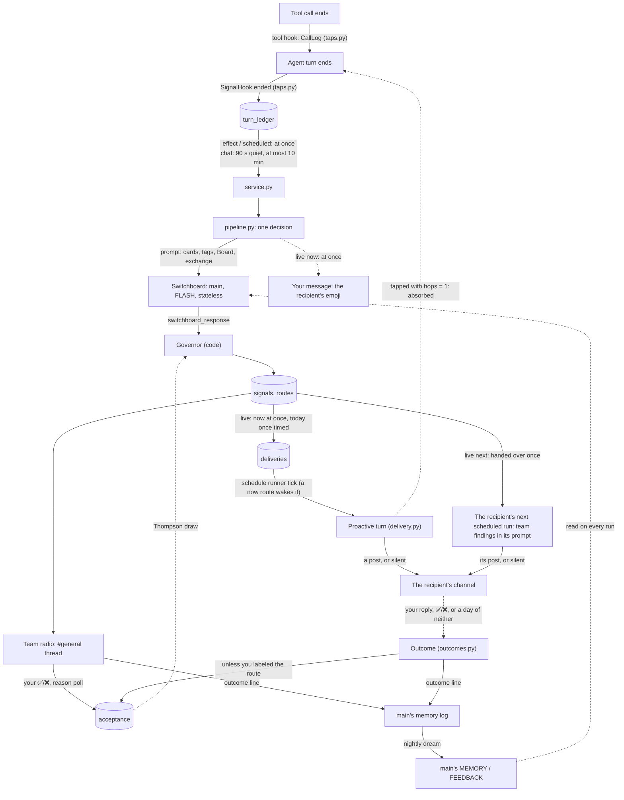

# Proactive Team

`core/proactive` lets an agent act on something another agent learned, without
you repeating it. After an agent's turn, the **Switchboard** (the Concierge's
model, off the critical path) reads what happened and names the teammates who
could use it. The **Governor** (code) decides what each of those routes may
become. Every decision shows up on **team radio**, a thread under `#general`,
where your ✅/❌ teach the system what's worth it.

main.py installs it in the bot process (`service.install`), so every host
taps the turns of the agents it runs. It has **one switch**, `PROACTIVE_DELIVERY`
(`core/config/settings.py`):

| `PROACTIVE_DELIVERY` | What happens |
|---|---|
| off (default) | **Shadow.** Turns are tapped, decided and shown on team radio, but **nothing reaches an agent or its channel**. A route only records when it *would* have been delivered. |
| on | **Live.** A `now` or `today` route the Governor lets through becomes a **proactive turn**: the recipient posts in its own channel, or stays silent, and a `now` route first puts the recipient's emoji on your message ([Delivery](#delivery)). A `next` route rides along on the recipient's next scheduled run ([The next touchpoint](#the-next-touchpoint)). Each agent also sees the live situations its topics cover ([Live Context](#live-context)). |

> [!IMPORTANT]
> Nothing here runs before a reply is out. The taps work in `ended`, after the
> turn; the Board is written on its own worker thread; and the only model call
> is the Switchboard's, in the background.

## Flow



## Files

| File | What it does |
|---|---|
| [taps.py](taps.py) | Turns a finished turn into a ledger entry: what was said, memory-log lines, effects, touched paths, skills. Picks the turns that count. `CallLog` hears the turn's tool calls. |
| [effects.py](effects.py) | The **one table** of what a tool's call means to the team: `ProactiveEffect` rows, trigger or context. |
| [service.py](service.py) | The taps' sink in the bot process. Records the entry and times the session's Switchboard run. `install()` hooks it in, from main.py. |
| [pipeline.py](pipeline.py) | One decision: claim the turns, run the Switchboard, judge each route, record it, then tell team radio. A step that fails becomes the decision's error. |
| [switchboard.py](switchboard.py) | Renders the prompt, runs `main` once, statelessly, and parses `<switchboard_response>`. |
| [governor.py](governor.py) | The rules, the acceptance draw, and when a route would be delivered. Its docstring lists the **dormant levers**. |
| [delivery.py](delivery.py) | Live only: an approved route becomes a **proactive turn**. The schedule runner's due work claims each due delivery once and runs it as a one-shot `DeliverySchedule`; a `<silent/>` reply posts nothing. A `next` route rides along on the recipient's next scheduled run instead (`SignalsForMe`). |
| [follow_ups.py](follow_ups.py) | Live only: a follow-up's due check. The schedule runner's due work claims each once and runs it as a one-shot `FollowUpSchedule`: a scan first, then a turn only for what's new. `FollowUpSweep` ends the ones past their `until`, with the switch on or off, and puts each one opened and closed on team radio. |
| [outcomes.py](outcomes.py) | What came of each proactive post: engaged, declined or ignored, from your reply, your ✅/❌, or a day of neither. Code decides it; it counts toward acceptance unless you labeled the route. |
| [cards.py](cards.py) | Peer cards: what each teammate wants and offers. They come from `agent.json` `proactivity`, or are derived from `description`. |
| [radio.py](radio.py) | Team radio's lines, your labels, the reason poll, and outcome lines. |
| [board.py](board.py) | One worker thread for every Board call. |

Elsewhere:
- **Board:** [core/storage/signals.py](../storage/signals.py), with its schema in [signals.sql](../storage/schemas/signals.sql).
- **Follow-ups:** [core/storage/follow_ups.py](../storage/follow_ups.py), with its schema in [follow_ups.sql](../storage/schemas/follow_ups.sql); the tool, [tools/follow_up.py](../../tools/follow_up.py); who gets it, `gets_follow_up` in [tools_loader.py](../loaders/tools_loader.py); and `!followups`, [core/runtime/commands/typed/followups.py](../runtime/commands/typed/followups.py).
- **Prompts:** [core/prompts/templates/proactive/switchboard.md](../prompts/templates/proactive/switchboard.md), the proactive turn's [delivery.md](../prompts/templates/proactive/delivery.md), a scheduled run's [team_findings.md](../prompts/templates/proactive/team_findings.md), and a follow-up's check, [follow_up.md](../prompts/templates/proactive/follow_up.md).
- **The runner that delivers:** [core/scheduler/schedule_runner.py](../scheduler/schedule_runner.py): its wake, its due work, and its briefings.
- **The `now` reaction on Discord:** [core/channel/discord/ack.py](../channel/discord/ack.py), and the message the runner's output remembers ([output.py](../channel/discord/output.py)).
- **Live Context:** [core/prompts/live_context.py](../prompts/live_context.py), with its query `SignalStore.live_situations` and its place in [graph_builder.py](../runtime/graph_builder.py).
- **Discord side of team radio:** [core/channel/discord/radio.py](../channel/discord/radio.py).
- **`!signals`:** [core/runtime/commands/typed/signals.py](../runtime/commands/typed/signals.py).
- **Outcome lines:** [core/knowledge/memory/outcomes.py](../knowledge/memory/outcomes.py).
- **Tool hooks:** [core/tooling/hooks.py](../tooling/hooks.py). Every finished tool call is announced there, by [transcript.py](../runtime/observability/transcript.py).
- **The memory replay:** [scripts/proactive_replay.py](../../scripts/proactive_replay.py). It re-runs your labeled decisions with and without main's memory.

## The taps

Each turn that counts leaves one `turn_ledger` row:

| Part | Where it comes from |
|---|---|
| `user_text`, `reply_text` | The prompt, without the `<caller>`, reply and hand-off wrappers, and the reply. At most 2,000 characters each. |
| `memory` | The reply's `<system_memory_log>` lines. |
| `effects` | Successful calls that the effects table counts, with trimmed arguments. |
| `context.touched` | Paths that the turn's `filesystem` writes changed. |
| `context.skills` | A loaded skill, or the one skill of the agent that lists a tool it called. |
| `context.message` | Your message that started the turn, `<channel id>/<message id>`, when the Discord runner started it. A live `now` route's reaction goes on it. |

**The effects table** ([effects.py](effects.py)) is the one place that says which tool calls matter. The tools know nothing of it:

| Row | Tools | Meaning |
|---|---|---|
| `ProactiveEffect(tool, TRIGGER)` | ledger_append, kitchen_inventory, calendar_add, log_workout_session | A successful call is a **trigger**: the Switchboard runs at once. |
| `ProactiveEffect(tool, CONTEXT)` | write_weekly_review, graph_call | Context for the Switchboard, not a trigger. |
| `ProactiveEffect(tool, CONTEXT, actions=...)` | home_assistant (`@control`, `@admin`), filesystem (`@change`, `paths=True`) | Only those actions. They're named in the tool's own vocabulary, with its permission bundles. Other actions are ignored. |

A tool that isn't in the table, and any failed call, is ignored. `tests/core/proactive/test_effects.py` checks that every tool and bundle named there exists.

These turns are skipped:
- any agent reachable everywhere (`channels: ["*"]`: the Concierge's routing turns, the graph workers);
- stateless agents;
- runs that record no memory (dreams, replays);
- steps inside a graph run;
- background jobs.

A message routed from a channel leaves one row, for the specialist that answered it.

## The Switchboard

`main`, run with `source="job"`, stateless, `model="FLASH"`, `thinking_level="low"` and `record_memory=False`:
- **No output port:** nothing is posted.
- **Session table:** dropped after the run. The decision keeps the prompt, the reply and the tokens.
- **System prompt:** keeps main's MEMORY and FEEDBACK. `AGENTS.md` and `SOUL.md` describe the job.

Every field it returns is checkable, and it never gives a confidence:

```xml
<switchboard_response>
  <signal kind="situation" tags="travel,family" until="2026-10-27" sensitivity="normal">
    <gist>The user and family are in Lake Tahoe Oct 23-27.</gist>
    <evidence>We're in Tahoe with the family until Tuesday</evidence>
    <route to="excursion-planner" offer="activity ideas" urgency="today" window="2026-10-24/2026-10-27">…</route>
  </signal>
  <errors>None</errors>
</switchboard_response>
```

## The Governor

Rules are checked in order. The first that settles a route decides:

| Rule | Verdict |
|---|---|
| Evidence not in the exchange, word for word | drop |
| Situation without `until`, or `until` past | drop |
| Recipient has no card, or is the agent the exchange was with | drop |
| Offer isn't one of the recipient's (a derived card takes any) | drop |
| Window outside the next 7 days | drop |
| Tagged `health`/`finance` and the recipient doesn't read that tag | drop |
| Recipient answered by another host | drop |
| Same fact, same recipient, within 72 h | drop |
| Switchboard asked for no message | absorb |
| Signal came from a proactive turn (`hops ≥ 1`) | absorb |
| You talked to the recipient in the last 10 minutes | absorb |
| `now` that isn't an artifact, a request or a window within 2 h | downgraded to `today` |
| `next` to a teammate with no scheduled run that posts (its card's `scheduled`) | made `today` |
| Acceptance draw below 0.3 | absorb |

The acceptance draw is Thompson sampling over `Beta(2 + engaged, 1 + ignored + declined)`, per recipient/kind/tag:
- A new kind of nudge gets the benefit of the doubt: it's posted about 9 times in 10.
- One you keep declining fades: about half are absorbed after 3 declines, and three in four after 6.

**When a route would be delivered** (`deliver_at`):
- `now`: at once.
- `today`: at your first 30-minute quiet stretch. If its window closes first, it moves to the next touchpoint.
- `next`: at the recipient's next scheduled run, or your next conversation with it. Live, it's delivered only on a scheduled run ([the next touchpoint](#the-next-touchpoint)), which is why a teammate without one (Ted, since `mode-a-queue` went) gets `today` instead.

`resolve_times` fills these in each minute (the service's sweep).

**Dormant levers** (quiet hours, delivery window, per-signal, per-agent, global and long-shot caps, open follow-ups) are written down in the Governor's docstring, each with the condition, seen in the shadow data, that switches it on.

## Delivery

With the switch on, each decision is **live**: a `now` or `today` route the Governor lets through becomes a **proactive turn**, a one-shot run of the recipient in its own home channel ([delivery.py](delivery.py)). A `next` route rides along on the recipient's next scheduled run instead ([below](#the-next-touchpoint)).

| Step | What happens |
|---|---|
| Approve | The pipeline approves a `now` route at once, and a `today` route when `resolve_times` knows its time: one `deliveries` row on the Board, for the recipient's home channel. A recipient with no home channel gets nothing. |
| Wake | A `now` approval wakes the schedule runner, so its 30 s sleep ends early. It's still one loop, one tick at a time. |
| React | A `now` approval also puts the recipient's card emoji on your message that started it, at once: the receipt gets 🧑‍🍳 seconds after it's saved, and Ramsay's post follows. The message is the one that started the source agent's latest turn in the decision (the taps' `context.message`); with none, there's no reaction. It's added by the recipient's bot if this host runs it and it sees the channel, else by main's ([ack.py](../channel/discord/ack.py)), and only where this host holds the recipient, as the delivery's own rule says: elsewhere the post may never come. It stays even if the turn stays silent: the recipient did take note. `acked_at` records when, against the target of p95 ≤ 10 s. A reaction that fails is logged; the delivery goes on. |
| Claim | Each tick, the runner's due work (`DueDeliveries`) first fails a row still running after 10 minutes (never run again) and an approved row due more than 3 hours ago (never posted late): for posts to you, at most once beats at least once. A row whose recipient this host doesn't hold right now is skipped, as `run_schedule` would; it stays approved, runs if the agent comes back, and expires otherwise. Every other due row is claimed with one conditional `UPDATE`, so it runs once. |
| Run | A `DeliverySchedule`, through `run_schedule`: the same ownership check and limiter as a schedule. Stateless, with source `proactive`, on the scheduled surface, at thinking level `low` (posts are short; target: post p95 ≤ 60 s). |
| Post | Like a scheduled post: in the channel, in the channel inbox with its speech version ("Ramsay has a suggestion"), and in the session that answers your reply. A reply of `<silent/>` posts nothing and records nothing. |
| Finish | `posted` (the route's `delivered_at` is set, and the ids of the messages it posted are kept), `silent` or `failed`. A post then gets its [outcome](#outcomes). |

The turn's prompt ([delivery.md](../prompts/templates/proactive/delivery.md)) says what a teammate learned (the gist, the evidence, the payload, until or the window) and what the recipient could offer, with the Switchboard's note. It never names that teammate. Its rules: first person, in its own voice; never mention another agent, the Switchboard, or how it learned this; one short message with at most one question or a poll; `<silent/>` if it already knows this, or it isn't useful now.

**No chains:** the taps give a proactive turn `hops = 1` and the scheduled tap, so the Governor absorbs any signal it starts.

**Rollback:** turn the switch off. The due work and the next touchpoint read it on every call, so nothing more is delivered. Approved rows wait; if it's turned back on, any due more than 3 hours ago expire unposted.

### The next touchpoint

A live `next` route isn't a proactive turn: it rides along on the recipient's next scheduled run, as findings after that run's own prompt. The runner asks each provider registered with `add_briefing` before a run; main.py registers the service's `SignalsForMe` ([delivery.py](delivery.py)).

| | |
|---|---|
| Which routes | The recipient's live `next` routes that no run has taken: emitted in the last 7 days, still true today (`until`), and with their window, if any, still open. At most 5, oldest first. `deliver_at` isn't read: `resolve_times` sets it in shadow too. |
| Which runs | A run whose source is `scheduled` and whose channel was found. Never a proactive turn, nor a run that posts nowhere. |
| The block | `<findings source="your team">`, one item per route: the gist, the details (never the payload's `tool`), until and the window, what the agent could offer, and the note ([team_findings.md](../prompts/templates/proactive/team_findings.md)). Its rules: use what fits this run, in your own voice; never name another agent or how you learned it; leave out what doesn't fit. |
| Once only | Each route is handed over once (`hand_over`: one `handed` deliveries row), so of two runs at once only one gets it. Nothing else touches a handed row: not the stuck or expiry rules, since a scheduled run can take longer than a proactive turn, and never a proactive turn. |
| Finish | The run finishes its routes: `posted` when its reply was recorded as a post (which doesn't say it used them), `silent` when it posted nothing, `failed` when it failed. |

> [!NOTE]
> `resolve_times` moves a `today` route to `next` only once its window has
> closed, so the window rule above leaves such a route out: it never rides along.

### Outcomes

Each proactive post gets one outcome, decided by code with no model ([outcomes.py](outcomes.py)). It's what "worth posting?" learns from when you give no label.

| Outcome | When |
|---|---|
| engaged | ✅ on one of its messages; or your first turn with the recipient after the post, within 24 h, is anything but a short no: a reply, a poll vote (it reaches the recipient as your message), asking it to act. |
| declined | ❌ on one of its messages; or that first turn is a short no: the whole reply is one of *no, nope, no thanks, not now, not interested, stop, skip, pass, don't, leave it*, or it's at most 4 words and starts with one ("not now, maybe later"), whatever the case and punctuation. "Skip the eggs, add the rest" and "no problem, add them" are engaged: a false decline would hold back a useful kind of nudge, and ❌ is there for a plain no. |
| ignored | Neither within 24 h. |

| | |
|---|---|
| Which posts | A proactive turn's, finished `posted`: a `now` or `today` route's. Not a `next` route's scheduled run, whose post says nothing about the item, nor a silent or failed turn. |
| Your turn | The ledger's first turn with the recipient after the post that you started (caller `main`, not a schedule). |
| The messages | The post keeps the ids of the messages it sent (`deliveries.message_ids`), so a ✅/❌ on any of them finds it. |
| It sticks | The first outcome stays, except that ❌ within 24 h turns engaged into declined. Every bot runner offers the same reaction, and each change is one guarded `UPDATE`, so a repeat changes nothing. |
| Counted once | A route counts once toward acceptance: your label if you gave one (team radio or `!signals`), else its outcome. A label given after the outcome takes over its count. |
| The line | One line in main's memory log per outcome, for tonight's dream: engaged is a precedent (`[MEMORY]`), declined or ignored a correction (`[FEEDBACK]`). |
| Where it runs | The service's sweep, each minute, after `resolve`; and a reaction listener after team radio's, so a ✅/❌ on a radio line stays a label. The listener lets the reaction go on: a ✅ on the post still finishes its channel's inbox row. A reaction first settles the post from the ledger, so the sweep's timing changes nothing. |

`!signals <id>` shows how each route's delivery went and what came of it (`posted +31 s · engaged`); `!signals why <link>` finds the decision behind a post; and `!signals stats` has the evidence: engaged / ignored / declined per agent (target ≥ 50% engaged, and ≤ 1 decline per agent a week, counted from the first live decision), a `now` route's reaction and post p95 after the turn it came from (targets ≤ 10 s and ≤ 60 s), and duplicate posts: the same fact posted to one agent twice within 72 h (target: none).

### Live Context

With the switch on, an agent also sees what's true right now: a `LIVE_CONTEXT` system block ([core/prompts/live_context.py](../prompts/live_context.py)) of the live situations on the Board that its `memory_topics` cover. It's working memory, next to the dream's long-term memory: nothing curates it, and its lines expire on their own.

```text
- The user and family are in Lake Tahoe Oct 23–27 (until 2026-10-27)
```

| | |
|---|---|
| Lines | `situation` signals with their evidence found, `until` today or later, learned in the last 14 days, whose tags meet the agent's topics. Newest first, at most 8, one line each, with no source named. A fact said twice shows once. As for routes, a health or finance fact shows only to an agent that reads that tag. |
| Who | An agent with memory topics. Never a stateless agent, nor a stateless or non-recording run (a job, a dream, a replay). |
| Where | Right after the agent's memory, before the channel block ([graph_builder.py](../runtime/graph_builder.py)): it changes a few times a day. |
| Cost | Asked for on every model call, so each agent's block is kept for 60 s. With the switch off, it's never read. |

> [!NOTE]
> A dream doesn't see Live Context: it records no memory, so it gets no block.

### Pilots and the dev check

The switch turns everything on at once. Three flows are the pilots:

| Pilot | Trigger | Route | What you see |
|---|---|---|---|
| 🧾 → 🧑‍🍳 receipts → Ramsay | Receipt Processor saves a grocery receipt (`ledger_append`, a trigger) | `now`, "update the kitchen inventory" | 🧑‍🍳 on your receipt within seconds, then Ramsay's suggestion in #meal-planning |
| 🌼 → 🏕️ situations → Eric | You tell Daisy about a trip or visitors | `today`, "activity ideas" | Eric's idea in #weekend-planning after your first 30-minute quiet stretch, and the trip in his Live Context |
| 🌿 → 🔬 knowledge gaps → Ted | William names a gap in his 07:00 summary | `today` (Ted has no scheduled run), "syllabi" | Ted offers a syllabus in #topic-research; say yes and he starts Mode A |

**Dev check, before going live.** Run a dev instance with `PROACTIVE_DELIVERY=1` in its `.env`, claiming the pilots' agents and main (team radio posts from whoever holds main):

```bash
python main.py --dev --agents main,receipt-processor,meal-planner,day-planner,excursion-planner,wiki-gardener,topic-researcher
```

| # | Do | Expect |
|---|---|---|
| P1 | Post a grocery receipt in #receipts | 🧑‍🍳 on it within ~10 s; Ramsay's post in #meal-planning within ~60 s; a radio line "delivering now" |
| P2 | Answer Ramsay: a poll vote, a few words, or ✅ | `!signals <id>` shows `posted +… · engaged` within a minute |
| P3 | Tell Daisy "we're in Tahoe Fri–Sun with the kids" | A `today` radio line for Eric, his post after 30 quiet minutes; ask Eric about the weekend and he knows (Live Context) |
| P4 | Ask Ted for a syllabus on something new | Mode A: an outline, and Chapter 1 saved under `pkm/wiki/topics/pending/` |
| P5 | `!signals stats` | Outcomes per agent, and the reaction and post times |

Each host keeps its own Board, so the dev check never touches prod's labels or acceptance.

**Going live:** set `PROACTIVE_DELIVERY=1` in prod's environment and restart. **Rollback:** unset it and restart: nothing more is delivered, and approved rows wait or expire.

## Follow-ups

When your goal isn't met yet and an agent can keep working on it, it opens a **follow-up**: its own open loop, with a goal, a check, a cadence and an end. It exists only while there's a need. The agent usually offers first ("Want me to keep watching?"), and always says in its reply what it will watch, and until when.

| | |
|---|---|
| Where it lives | One row in `follow_ups`, in `memory.db` ([follow_ups.py](../storage/follow_ups.py), [follow_ups.sql](../storage/schemas/follow_ups.sql)): the goal, the check, `every` (the cadence asked) and `interval_s` (the cadence now), `until` (its last day), `close_when` (what would end it early), and the channel and session it was opened in. Only the tool opens one. The store reads each row as a frozen `FollowUp`, its check a `Check` and its states enums. |
| The check | A short model turn, `{"type": "model", "what": "..."}` (`what` at most 300 characters), or one of the agent's own scans (`agents/<agent>/preconditions/`) with its args, like a schedule's precondition. |
| The tool | `follow_up` ([tools/follow_up.py](../../tools/follow_up.py)): `open`, `close` and `list`, always the calling agent's own. `open` needs a goal (at most 300 characters), a check, `every` (6 h to 7 d) and `until` (today to 90 days out). It refuses a second open follow-up with the same check: the same agent, and the check written the same once case and spacing are set aside. `open` works only in a conversation, once you've agreed: on the scheduled surface (a scheduled run, a delivery, a check) the agent may offer one, but not open it. `close` and `list` work everywhere, so a check closes its own follow-up when its goal is met. |
| What it's for | Work the agent can do: checking, searching, re-evaluating. Reminders for you stay in your task system. |
| Who gets it | Auto-added, like `load_skill`, to every run that keeps memory ([tools_loader.py](../loaders/tools_loader.py) `gets_follow_up`): not a stateless agent or run (a job), a dream or a replay, a graph step, nor the Concierge. An agent opts out with `"proactivity": {"follow_ups": false}`. A run with the tool gets its own compiled graph, so a job that builds an agent's graph first can't take it from the agent's conversations. |
| How it's checked | The schedule runner's third source of work ([follow_ups.py](follow_ups.py)): each tick, `DueFollowUps` claims the due checks once, at most 5, held here, and runs each as a one-shot `FollowUpSchedule` in the agent's home channel (else where it was opened). A scan check runs first, in code: nothing found, or the same findings as last time (a fingerprint), and no turn runs; what it couldn't read is posted once a day. A model check is a short turn every time. The turn ([follow_up.md](../prompts/templates/proactive/follow_up.md)) sees the goal, how long it has watched and what it last told you, then posts one short message or stays `<silent/>`. A claim left by a run that never finished is freed after an hour. |
| Its source | `followup`: on the scheduled surface, like a delivery (its post enters the channel inbox, and can be heard in a voice briefing). The taps read it like a scheduled run, hops 0, so what it finds can reach teammates. It's never briefed with `next` routes. |
| Cadence | A post resets it to `every`. Every 3rd empty check in a row (nothing found, nothing new, or a silent reply) doubles it, up to 7 days. When less than two intervals are left before `until` ends, it's back to `every`. `!followups` shows both: "every 4d (asked 2d)". |
| How it ends | The agent closes it (often in a check that met the goal), you cancel it, or `until` passes: the service's sweep closes it within a minute, with the switch on or off. A check that closes its own follow-up still counts. |
| `!followups` | The open ones, soonest check first (agent, goal, cadence, next check, until, checks and finds); `closed`, the last 10 with why; `cancel <id> [why]`, any agent's, as you ([followups.py](../runtime/commands/typed/followups.py)). With the switch off and some open, a ⏸ banner says nothing is checked. |
| Team radio | A line when one opens and when it closes, from the same sweep, once each, without reactions: `📻 🔁 ✈️ Miles opened follow-up #12 · <goal> · every 2d until 2026-12-15 · check: award_watch`, and `📻 🔁 ✈️ Miles closed follow-up #12 · <goal> · you cancelled it · 6 checks, 1 find`. A closed line waits for a running check to finish, so it counts it. Lines for events over a day old are skipped. |
| Live Context | The agent's own open follow-ups, soonest `until` first, at most 5, in their own part of its Live Context (`<your_follow_ups>`), even without memory topics: it knows what it's watching, won't offer a duplicate, and closes one when you say it's done. |
| The switch | Off: no `follow_up` in any prompt, the tool refuses every op, and nothing is checked; ending at `until` and the radio lines go on. On: the tool and the checks. |

## Team radio and `!signals`

```text
📻 #42 🧾→🧑‍🍳 now · Groceries from 99 Ranch, Oct 24 · would deliver at once
📻 #43 🌼→🏕️ today · The user and family are in Lake Tahoe until Tue · held for your first quiet stretch
📻 #44 🌿→🔬 dropped · No wiki page for prompt caching · evidence not found in the exchange
```

**Labeling a line:**
- React ✅ or ❌ on it. A dropped route was never offered, so its line takes no label.
- ❌ brings a poll under the line: *wrong agent · wrong timing · not worth it · wrong fact*.
- A label counts toward acceptance at once, in place of the route's [outcome](#outcomes) if its post had one, and writes one outcome line in main's memory log for tonight's dream.

**Hosts:** only the host that answers for `main` posts team radio and answers `!signals`. Each host keeps its own Board, and every host taps the agents it runs. So to see a dev host's decisions, claim `main` on it: otherwise they're recorded but never shown, and `!signals` shows the other host's Board.

**`!signals` (no model):**

| Command | Shows or does |
|---|---|
| `!signals` | The last 10 decisions. |
| `!signals <id>` | One decision's full trace, with how each route's delivery went and what came of it. |
| `!signals <id> good` | Labels its offered routes right. |
| `!signals <id> bad <why>` | Labels them wrong, with a reason. |
| `!signals missed <what>` | Records a route the Switchboard should have made. |
| `!signals missed` | The missed routes you reported. |
| `!signals stats` | The last 14 days, against the targets (≥ 30 labels, precision ≥ 0.8), when deliveries would land, the posts' outcomes per agent, and how fast `now` routes came, each against its target. |
| `!signals why <message link>` | The decision behind a team radio line, or behind a proactive post. |

## Measuring before going live

Go live after ≥ 2 weeks of shadow running in prod and ≥ 30 labeled decisions. Where each piece of evidence comes from:

| Evidence | Where |
|---|---|
| Precision, target ≥ 0.8 | `!signals stats` |
| The missed-route list | `!signals missed` |
| Timing per tap | `!signals stats`: the median wait before the decision, and the run, per tap |
| Tokens a day, against the estimate (30–60 runs × 3–4k tokens) | `!signals stats` |
| The "would deliver at" distribution | `!signals stats`: per urgency, and by time of day. Night deliveries are the case for the quiet-hours lever. |
| `first_token` p50/p95 unchanged | [scripts/compare_token_stats.py](../../scripts/compare_token_stats.py) `--voice`, twice: `--since <2 weeks before> --until <shadow on>`, then `--since <shadow on>`. Compare the `first_token` rows. |
| Is main's dream worth keeping? | The memory replay, [scripts/proactive_replay.py](../../scripts/proactive_replay.py): your labeled decisions, re-run with and without main's memory |

> [!NOTE]
> Only voice turns are traced, so `first_token` is measured on voice. Text
> turns aren't traced, but the taps can't slow them: they run in `ended`,
> after the reply is out.

## Tests

| What | Where |
|---|---|
| The proactive package, with the effects table | `tests/core/proactive/` (one file per module) |
| Outcomes: each rule, the short no, repeats, the ❌ override, labels, and what gets none | `tests/core/proactive/test_outcomes.py` |
| The whole path, shadow and live (a stub agent posts, or stays silent; the `now` reaction; your ✅ on the post; a `next` route on a scheduled run) | `tests/core/proactive/test_end_to_end.py` |
| The tool hooks | `tests/core/tooling/test_hooks.py`, and `test_transcript.py` for who announces |
| The Board | `tests/core/storage/test_signals.py` |
| The schedule runner's wake, due work and briefings | `tests/core/scheduler/test_schedule_runner.py` |
| Live Context, and its place in the system prompt | `tests/core/prompts/test_live_context.py`, `test_system_caching.py` |
| The Discord side and the runner's hooks | `tests/core/channel/discord/test_radio.py`, `test_ack.py`, `test_output.py`, `test_runner.py`, `test_dispatcher.py` |
| `!signals` | `tests/core/runtime/commands/typed/test_signals.py` |
| Follow-ups: the store, the tool, the checks, the sweep and `!followups` | `tests/core/storage/test_follow_ups.py`, `tests/tools/test_follow_up.py`, `tests/core/proactive/test_follow_ups.py`, `tests/core/runtime/commands/typed/test_followups.py` |
| The memory replay | `tests/scripts/test_proactive_replay.py` |
