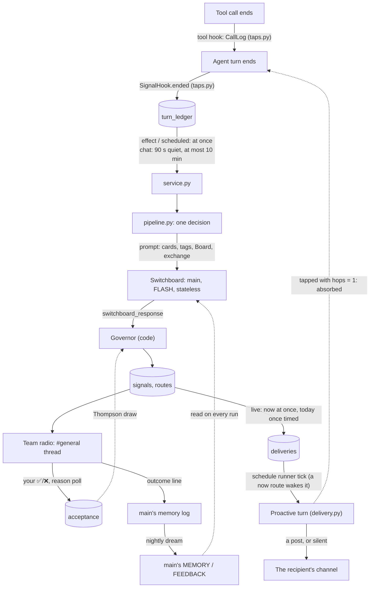

# Proactive Team

`core/proactive` lets an agent act on something another agent learned, without
you repeating it. After an agent's turn, the **Switchboard** (the Concierge's
model, off the critical path) reads what happened and names the teammates who
could use it. The **Governor** (code) decides what each of those routes may
become. Every decision shows up on **team radio**, a thread under `#general`,
where your ✅/❌ teach the system what's worth it.

main.py installs it in the bot process (`service.install`), so every host
taps the turns of the agents it runs. It has **one switch**, `PROACTIVE_DELIVERY`
(`core/config/settings.py`):

| `PROACTIVE_DELIVERY` | What happens |
|---|---|
| off (default) | **Shadow.** Turns are tapped, decided and shown on team radio, but **nothing reaches an agent or its channel**. A route only records when it *would* have been delivered. |
| on | **Live** (stage S4). A `now` or `today` route the Governor lets through becomes a **proactive turn**: the recipient posts in its own channel, or stays silent ([Delivery](#delivery-s4)). A `next` route still only records its time. Each agent also sees the live situations its topics cover ([Live Context](#live-context)). It's turned on at G3. |

> [!IMPORTANT]
> Nothing here runs before a reply is out. The taps work in `ended`, after the
> turn; the Board is written on its own worker thread; and the only model call
> is the Switchboard's, in the background.

## Flow



## Files

| File | What it does |
|---|---|
| [taps.py](taps.py) | Turns a finished turn into a ledger entry: what was said, memory-log lines, effects, touched paths, skills. Picks the turns that count. `CallLog` hears the turn's tool calls. |
| [effects.py](effects.py) | The **one table** of what a tool's call means to the team: `ProactiveEffect` rows, trigger or context. |
| [service.py](service.py) | The taps' sink in the bot process. Records the entry and times the session's Switchboard run. `install()` hooks it in, from main.py. |
| [pipeline.py](pipeline.py) | One decision: claim the turns, run the Switchboard, judge each route, record it, then tell team radio. A step that fails becomes the decision's error. |
| [switchboard.py](switchboard.py) | Renders the prompt, runs `main` once, statelessly, and parses `<switchboard_response>`. |
| [governor.py](governor.py) | The rules, the acceptance draw, and when a route would be delivered. Its docstring lists the **dormant levers**. |
| [delivery.py](delivery.py) | Live only: an approved route becomes a **proactive turn**. The schedule runner's due work claims each due delivery once and runs it as a one-shot `DeliverySchedule`; a `<silent/>` reply posts nothing. |
| [cards.py](cards.py) | Peer cards: what each teammate wants and offers. They come from `agent.json` `proactivity`, or are derived from `description`. |
| [radio.py](radio.py) | Team radio's lines, your labels, the reason poll, and outcome lines. |
| [board.py](board.py) | One worker thread for every Board call. |

Elsewhere:
- **Board:** [core/storage/signals.py](../storage/signals.py), with its schema in [signals.sql](../storage/schemas/signals.sql).
- **Prompts:** [core/prompts/templates/proactive/switchboard.md](../prompts/templates/proactive/switchboard.md), and the proactive turn's [delivery.md](../prompts/templates/proactive/delivery.md).
- **The runner that delivers:** [core/scheduler/schedule_runner.py](../scheduler/schedule_runner.py): its wake, and its due work.
- **Live Context:** [core/prompts/live_context.py](../prompts/live_context.py), with its query `SignalStore.live_situations` and its place in [graph_builder.py](../runtime/graph_builder.py).
- **Discord side of team radio:** [core/channel/discord/radio.py](../channel/discord/radio.py).
- **`!signals`:** [core/runtime/commands/typed/signals.py](../runtime/commands/typed/signals.py).
- **Outcome lines:** [core/knowledge/memory/outcomes.py](../knowledge/memory/outcomes.py).
- **Tool hooks:** [core/tooling/hooks.py](../tooling/hooks.py). Every finished tool call is announced there, by [transcript.py](../runtime/observability/transcript.py).
- **G3's D20 replay:** [scripts/proactive_replay.py](../../scripts/proactive_replay.py). It re-runs your labeled decisions with and without main's memory.

## The taps

Each turn that counts leaves one `turn_ledger` row:

| Part | Where it comes from |
|---|---|
| `user_text`, `reply_text` | The prompt, without the `<caller>`, reply and hand-off wrappers, and the reply. At most 2,000 characters each. |
| `memory` | The reply's `<system_memory_log>` lines. |
| `effects` | Successful calls that the effects table counts, with trimmed arguments. |
| `context.touched` | Paths that the turn's `filesystem` writes changed. |
| `context.skills` | A loaded skill, or the one skill of the agent that lists a tool it called. |

**The effects table** ([effects.py](effects.py)) is the one place that says which tool calls matter. The tools know nothing of it:

| Row | Tools | Meaning |
|---|---|---|
| `ProactiveEffect(tool, TRIGGER)` | ledger_append, kitchen_inventory, calendar_add, log_workout_session | A successful call is a **trigger**: the Switchboard runs at once. |
| `ProactiveEffect(tool, CONTEXT)` | write_weekly_review, graph_call | Context for the Switchboard, not a trigger. |
| `ProactiveEffect(tool, CONTEXT, actions=...)` | home_assistant (`@control`, `@admin`), filesystem (`@change`, `paths=True`) | Only those actions. They're named in the tool's own vocabulary, with its permission bundles. Other actions are ignored. |

A tool that isn't in the table, and any failed call, is ignored. `tests/core/proactive/test_effects.py` checks that every tool and bundle named there exists.

These turns are skipped:
- any agent reachable everywhere (`channels: ["*"]`: the Concierge's routing turns, the graph workers);
- stateless agents;
- runs that record no memory (dreams, replays);
- steps inside a graph run;
- background jobs.

A message routed from a channel leaves one row, for the specialist that answered it.

## The Switchboard

`main`, run with `source="job"`, stateless, `model="FLASH"`, `thinking_level="low"` and `record_memory=False`:
- **No output port:** nothing is posted.
- **Session table:** dropped after the run. The decision keeps the prompt, the reply and the tokens.
- **System prompt:** keeps main's MEMORY and FEEDBACK. `AGENTS.md` and `SOUL.md` describe the job.

Every field it returns is checkable, and it never gives a confidence:

```xml
<switchboard_response>
  <signal kind="situation" tags="travel,family" until="2026-10-27" sensitivity="normal">
    <gist>The user and family are in Lake Tahoe Oct 23-27.</gist>
    <evidence>We're in Tahoe with the family until Tuesday</evidence>
    <route to="excursion-planner" offer="activity ideas" urgency="today" window="2026-10-24/2026-10-27">…</route>
  </signal>
  <errors>None</errors>
</switchboard_response>
```

## The Governor

Rules are checked in order. The first that settles a route decides:

| Rule | Verdict |
|---|---|
| Evidence not in the exchange, word for word | drop |
| Situation without `until`, or `until` past | drop |
| Recipient has no card, or is the agent the exchange was with | drop |
| Offer isn't one of the recipient's (a derived card takes any) | drop |
| Window outside the next 7 days | drop |
| Tagged `health`/`finance` and the recipient doesn't read that tag | drop |
| Recipient answered by another host | drop |
| Same fact, same recipient, within 72 h | drop |
| Switchboard asked for no message | absorb |
| Signal came from a proactive turn (`hops ≥ 1`) | absorb |
| You talked to the recipient in the last 10 minutes | absorb |
| `now` that isn't an artifact, a request or a window within 2 h | downgraded to `today` |
| Acceptance draw below 0.3 | absorb |

The acceptance draw is Thompson sampling over `Beta(2 + engaged, 1 + ignored + declined)`, per recipient/kind/tag:
- A new kind of nudge gets the benefit of the doubt: it's posted about 9 times in 10.
- One you keep declining fades: about half are absorbed after 3 declines, and three in four after 6.

**When a route would be delivered** (`deliver_at`):
- `now`: at once.
- `today`: at your first 30-minute quiet stretch. If its window closes first, it moves to the next touchpoint.
- `next`: at the recipient's next scheduled run, or your next conversation with it.

`resolve_times` fills these in each minute (the service's sweep).

**Dormant levers** (quiet hours, delivery window, per-signal, per-agent, global and long-shot caps, open follow-ups) are written down in the Governor's docstring, each with the condition that switches it on. They're decided at the gates, from shadow data.

## Delivery (S4)

With the switch on, each decision is **live**: a `deliver` verdict becomes a **proactive turn**, a one-shot run of the recipient in its own home channel ([delivery.py](delivery.py)).

| Step | What happens |
|---|---|
| Approve | The pipeline approves a `now` route at once, and a `today` route when `resolve_times` knows its time: one `deliveries` row on the Board, for the recipient's home channel. A recipient with no home channel gets nothing. A `next` route isn't delivered this way: it will reach the recipient's next run (part 3). |
| Wake | A `now` approval wakes the schedule runner, so its 30 s sleep ends early. It's still one loop, one tick at a time. |
| Claim | Each tick, the runner's due work (`DueDeliveries`) first fails a row still running after 10 minutes (never run again) and an approved row due more than 3 hours ago (never posted late): for posts to you, at most once beats at least once. A row whose recipient this host doesn't hold right now is skipped, as `run_schedule` would; it stays approved, runs if the agent comes back, and expires otherwise. Every other due row is claimed with one conditional `UPDATE`, so it runs once. |
| Run | A `DeliverySchedule`, through `run_schedule`: the same ownership check and limiter as a schedule. Stateless, with source `proactive`, on the scheduled surface, at thinking level `low` (posts are short; G4 wants post p95 ≤ 60 s). |
| Post | Like a scheduled post: in the channel, in the channel inbox with its speech version ("Ramsay has a suggestion"), and in the session that answers your reply. A reply of `<silent/>` posts nothing and records nothing. |
| Finish | `posted` (the route's `delivered_at` is set), `silent` or `failed`. |

The turn's prompt ([delivery.md](../prompts/templates/proactive/delivery.md)) says what a teammate learned (the gist, the evidence, the payload, until or the window) and what the recipient could offer, with the Switchboard's note. It never names that teammate. Its rules: first person, in its own voice; never mention another agent, the Switchboard, or how it learned this; one short message with at most one question or a poll; `<silent/>` if it already knows this, or it isn't useful now.

**No chains:** the taps give a proactive turn `hops = 1` and the scheduled tap, so the Governor absorbs any signal it starts.

**Rollback:** turn the switch off. The due work reads it on every tick, so nothing more is delivered. Approved rows wait; if it's turned back on, any due more than 3 hours ago expire unposted.

### Live Context

With the switch on, an agent also sees what's true right now: a `LIVE_CONTEXT` system block ([core/prompts/live_context.py](../prompts/live_context.py)) of the live situations on the Board that its `memory_topics` cover. It's working memory, next to the dream's long-term memory: nothing curates it, and its lines expire on their own.

```text
- The user and family are in Lake Tahoe Oct 23–27 (until 2026-10-27)
```

| | |
|---|---|
| Lines | `situation` signals with their evidence found, `until` today or later, learned in the last 14 days, whose tags meet the agent's topics. Newest first, at most 8, one line each, with no source named. A fact said twice shows once. As for routes (D10), a health or finance fact shows only to an agent that reads that tag. |
| Who | An agent with memory topics. Never a stateless agent, nor a stateless or non-recording run (a job, a dream, a replay). |
| Where | Right after the agent's memory, before the channel block ([graph_builder.py](../runtime/graph_builder.py)): it changes a few times a day. |
| Cost | Asked for on every model call, so each agent's block is kept for 60 s. With the switch off, it's never read. |

> [!NOTE]
> The dream reading the day's signals, to promote the lasting situations into topics (review record §6.4), isn't part of this. A dream doesn't see Live Context either: it records no memory, so it gets no block.

## Team radio and `!signals`

```text
📻 #42 🧾→🧑‍🍳 now · Groceries from 99 Ranch, Oct 24 · would deliver at once
📻 #43 🌼→🏕️ today · The user and family are in Lake Tahoe until Tue · held for your first quiet stretch
📻 #44 🌿→🔬 dropped · No wiki page for prompt caching · evidence not found in the exchange
```

**Labeling a line:**
- React ✅ or ❌ on it. A dropped route was never offered, so its line takes no label.
- ❌ brings a poll under the line: *wrong agent · wrong timing · not worth it · wrong fact*.
- A label counts toward acceptance at once, and writes one outcome line in main's memory log for tonight's dream.

**Hosts:** only the host that answers for `main` posts team radio and answers `!signals`. Each host keeps its own Board, and every host taps the agents it runs. So to see a dev host's decisions, claim `main` on it: otherwise they're recorded but never shown, and `!signals` shows the other host's Board.

**`!signals` (no model):**

| Command | Shows or does |
|---|---|
| `!signals` | The last 10 decisions. |
| `!signals <id>` | One decision's full trace. |
| `!signals <id> good` | Labels its offered routes right. |
| `!signals <id> bad <why>` | Labels them wrong, with a reason. |
| `!signals missed <what>` | Records a route the Switchboard should have made. |
| `!signals missed` | The missed routes you reported. |
| `!signals stats` | The last 14 days, against G3's targets (≥ 30 labels, precision ≥ 0.8), and when deliveries would land. |
| `!signals why <radio line link>` | The decision behind that line. |

## Measuring for G3

G3 comes after ≥ 2 weeks of shadow running in prod and ≥ 30 labeled decisions. Where each piece of evidence comes from:

| Evidence | Where |
|---|---|
| Precision, target ≥ 0.8 | `!signals stats` |
| The missed-route list | `!signals missed` |
| Timing per tap | `!signals stats`: the median wait before the decision, and the run, per tap |
| Tokens a day, against the estimate (30–60 runs × 3–4k tokens) | `!signals stats` |
| The "would deliver at" distribution | `!signals stats`: per urgency, and by time of day. Night deliveries are the case for the quiet-hours lever. |
| `first_token` p50/p95 unchanged | [scripts/compare_token_stats.py](../../scripts/compare_token_stats.py) `--voice`, twice: `--since <2 weeks before> --until <shadow on>`, then `--since <shadow on>`. Compare the `first_token` rows. |
| D20: is main's dream worth keeping? | [scripts/proactive_replay.py](../../scripts/proactive_replay.py): your labeled decisions, re-run with and without main's memory |

> [!NOTE]
> Only voice turns are traced, so `first_token` is measured on voice. Text
> turns aren't traced, but the taps can't slow them: they run in `ended`,
> after the reply is out.

## Tests

| What | Where |
|---|---|
| The proactive package, with the effects table | `tests/core/proactive/` (one file per module) |
| The whole path, shadow and live (a stub agent posts, or stays silent) | `tests/core/proactive/test_end_to_end.py` |
| The tool hooks | `tests/core/tooling/test_hooks.py`, and `test_transcript.py` for who announces |
| The Board | `tests/core/storage/test_signals.py` |
| The schedule runner's wake and due work | `tests/core/scheduler/test_schedule_runner.py` |
| Live Context, and its place in the system prompt | `tests/core/prompts/test_live_context.py`, `test_system_caching.py` |
| The Discord side and the runner's hooks | `tests/core/channel/discord/test_radio.py`, `test_runner.py`, `test_dispatcher.py` |
| `!signals` | `tests/core/runtime/commands/typed/test_signals.py` |
| The D20 replay | `tests/scripts/test_proactive_replay.py` |
