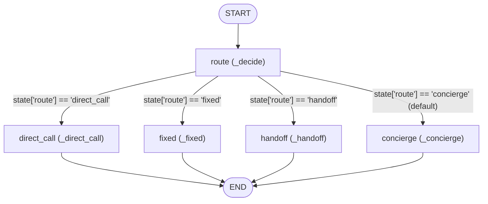

# Main Graph

`graphs/main` is the default LangGraph workflow for **every** agent in the
system: [`GraphBuilder.build_graph`](../../core/runtime/graph_builder.py#L194-L209)
reads `config.get("graph", "main")` and no `agent.json` currently overrides it.
The graph puts a deterministic router in front of the conversational ReAct
agent. A turn whose answer is already fixed by configuration — a channel in
which exactly one specialist is allowed to answer — is delegated without any
model call. A message in a channel no single agent answers (`#general`) gets a
fixed line, also without a model call. A message that calls another agent by
name ("Ted, create a syllabus on THIS topic") is handed to that agent in its
own channel, with a capsule of the conversation it came from (behind
`HANDOFF_ENABLED`). Every other turn — the executing agent's own — reaches the
concierge (the ReAct agent) as before. It runs on every message an agent
handles: Discord messages, voice turns, scheduled jobs, `agent_call`
delegations, and `graph_call` invocations all execute through the compiled
graph returned by [create_graph](graph.py#L84-L266).

> [!IMPORTANT]
> Because this graph is shared by all agents, the router must stay **inert**
> for specialists. Any change here has to keep an agent that does not host
> the channel, or lists it in its own `channels`, or is running a turn
> addressed to it (a delegation, job or schedule), on the concierge path — see
> [routing_enabled](../../core/runtime/foundation/routing.py#L77-L100).

## Workflow



The conditional edge is
`lambda state: state.get("route") or CONCIERGE`, mapped to
`{DIRECT_CALL: DIRECT_CALL, FIXED: FIXED, HANDOFF: HANDOFF, CONCIERGE: CONCIERGE}`
([graph.py:L256-L260](graph.py#L256-L260)),
so a missing or empty `route` falls back to `concierge`.

The `concierge` node wraps an inner `create_react_agent(llm, tools, prompt=prompt)`
which runs its own model/tool loop internally; that loop is not expressed as
nodes of this graph.

## State

The state schema is `RouterState`, a subclass of `MessagesState`
([graph.py:L242-L246](graph.py#L242-L246)).

| Field | Type | Description |
| --- | --- | --- |
| `messages` | `list[BaseMessage]` (from `MessagesState`) | Conversation history. Nodes return new messages; the compiled graph persists them via the checkpointer. |
| `route` | `str` | Route target chosen by `route`: `"direct_call"`, `"fixed"`, `"handoff"` or `"concierge"`. Read by the conditional edge. |
| `route_agent_id` | `Optional[str]` | Target agent id when the route is `direct_call` or `handoff`; `None` otherwise. |
| `route_reason` | `str` | Human-readable rule that fired (e.g. `"sole eligible agent in #receipts"`). Kept for logs and tests, not consumed by any edge. |
| `route_channel` | `Optional[str]` | Where a `handoff` continues: the named agent's home channel. `None` otherwise. |

## Nodes

### `route`

[_decide](graph.py#L91-L124) — resolves the
route and stashes it for the conditional edge. Synchronous and model-free.

- **Inputs from state:** `messages` (only the last message's `content` is
  read, as `latest`, and carried into the decision unchanged).
- **Other inputs:** the ambient
  [`ExecutionContext`](../../core/runtime/foundation/context.py#L94-L136)
  via `try_context()` (for `agent_id`, `channel_name` and `source`), the agent
  config captured at build time, a fresh
  [`AgentsLoader`](../../core/loaders/agents_loader.py#L99-L130)
  as the routing-table source, and two flags from
  [`Config()`](../../core/config/settings.py#L150-L156):
  `routing_llm_fallback` (the rollback switch) and `handoff_enabled`. When
  there is no active context it falls back to `owner_agent_id` (from
  `agent_id`/`config["agent_id"]`/`config["id"]`), an empty channel name and
  an empty source — which makes `routing_enabled` false, i.e. concierge.
- **Writes to state:** `route`, `route_agent_id`, `route_reason`,
  `route_channel`. It never rewrites the message.
- **Side effects:** prints `[graphs.main] Routing to '<agent>' (<reason>)` when
  the decision is direct, `[graphs.main] Handing off to '<agent>' (<reason>)`
  for a hand-off, and `[graphs.main] Fixed line (<reason>)` when it is fixed.
- **Routes to:** `direct_call`, `fixed`, `handoff` or `concierge`.

### `direct_call`

[_direct_call](graph.py#L126-L159) — hands
the turn to the one agent allowed to answer in this channel. Async.

- **Inputs from state:** `messages[-1].content` as the user prompt,
  `route_agent_id` as the delegation target.
- **Other inputs:** the ambient context for `channel_name` and the calling
  `agent_id` (falling back to `owner_agent_id`).
- **Behavior:** awaits
  [stream_delegate](../../core/runtime/delegation.py#L115),
  the single shared delegation path (also used by the `agent_call` tool), so
  the streamed header, custom events, channel-permission check and `<caller>`
  prefix are identical on both paths.
  - On failure it does **not** raise: it logs to stderr and returns
    `AIMessage("Could not reach \`<target>\`: <error>")`, because a
    misconfigured channel should say so in the channel rather than crash the
    graph ([graph.py:L142-L146](graph.py#L142-L146)).
  - On success the reply text is prefixed with
    [agent_header](../../core/runtime/delegation.py#L108-L112)
    (`emoji Name: `). Attribution matters: this text becomes part of the
    orchestrator's own history, and an unattributed reply would later read as
    something the orchestrator itself said and reasoned its way to.
  - When a context is active it calls
    [_record_turn](graph.py#L47-L65), which
    appends the `user` and `ai` messages to
    [`SessionStore`](../../core/storage/sessions.py). This is
    needed because the session log is populated by `LoggingHandler`'s *LLM*
    callbacks, and a routed turn never calls a model — without it the
    transcript would skip every deterministic exchange.
- **Writes to state:** `messages` — a single `AIMessage` with the attributed
  text (or `result.text`, or the error message).
- **Routes to:** `END`.

### `fixed`

[_fixed](graph.py#L161-L180) — answers a
message in a channel no single agent answers with a fixed line. Async; no
model runs.

- **Inputs from state:** `messages[-1].content`, for the session log only.
- **Other inputs:** the ambient context's surface
  ([`get_surface`](../../core/runtime/foundation/context.py#L243-L249)).
- **Behavior:** [fixed_reply](graph.py#L68-L76) picks the line:
  - typed: `UNADDRESSED_TEXT` — post in the agent's own channel, or type
    `!help` for commands. It doesn't suggest addressing an agent by name:
    with `HANDOFF_ENABLED` off, that would only bring the user back to this
    line;
  - spoken (the voice lobby): `<speech>Who's it for? Say 'switch to Daisy'.</speech>`
    — only a `<speech>` block, so the voice speaks it and the channel shows it
    as the whole reply.

  The line is dispatched as a
  [`NODE_STREAM_TOKEN`](../../core/runtime/foundation/events.py) custom event
  as well as returned: the channel would show it from the final state anyway,
  but the voice speaks only what streams. The node then calls `_record_turn`,
  for the same reason `direct_call` does.
- **Writes to state:** `messages` — a single `AIMessage` with the line.
- **Routes to:** `END`.

### `handoff`

[_handoff](graph.py#L182-L233) — hands a
message that calls another agent by name to that agent, in the agent's home
channel. Async; no model runs on the host.

- **Inputs from state:** `messages[-1].content` as the user prompt,
  `route_agent_id` as the named agent, `route_channel` as its home channel.
- **Other inputs:** the ambient context's channel (object, or name), to find
  the conversation the message came from.
- **Behavior:**
  1. Builds the capsule with
     [capsule_for](../../core/runtime/history/handoff.py): the last few
     exchanges of the session that answers the source channel (a specialist's
     `<agent>:tool:<channel>`, or the host's own in `#general`), the pruner's
     summary if there is one, and the files touched, capped at about 1,500
     tokens. It only reads that session.
  2. Dispatches a [`ROUTE_HANDOFF`](../../core/runtime/foundation/events.py)
     custom event (`agent_id`, `name`, `emoji`, `channel`, `pointer`,
     `request`), which the stream turns into a `HANDOFF` event. A reader that
     knows it ends the reply in the source channel with the pointer
     (`→ 🔬 Ted has this in #topic-research`) and shows what follows in the
     named agent's channel; one that doesn't shows everything in place.
  3. Awaits `stream_delegate(agent_id, with_capsule(prompt, capsule),
     channel=<home>)`: the named agent answers on the same session its own
     channel's messages use (`<agent>:tool:<home>`), so you carry on there. Its
     reply becomes the turn's `FINAL_RESPONSE` (`Agent.execute_stream`
     prefers a delegated agent's response).
  4. Calls `_record_turn` with the user's words and the pointer.
  - On failure it returns `AIMessage("Could not hand this to \`<target>\`:
    <error>")` and records nothing.
- **Writes to state:** `messages` — a single `AIMessage` with the pointer. The
  named agent's reply never enters this turn's history: the source channel's
  conversation is not continued with it.
- **Routes to:** `END`.

### `concierge`

[_concierge](graph.py#L235-L240) — the
ReAct behaviour, for turns that are the executing agent's own. Async.

- **Inputs from state:** `messages` (the full list), plus the LangGraph
  `config` passed through as `config_`.
- **Behavior:** awaits `concierge_agent.ainvoke({"messages": existing}, config_)`
  where `concierge_agent = create_react_agent(llm, tools, prompt=prompt)` was
  built once in `create_graph`, then slices off only the messages the inner
  agent produced (`result["messages"][len(existing):]`) so the pre-existing
  history is not re-emitted into the outer state.
- **Writes to state:** `messages` — only the newly produced messages.
- **Routes to:** `END`.

## Routing

All routing logic lives in [core/runtime/foundation/routing.py](../../core/runtime/foundation/routing.py),
where voice and channel posts use it too, and is deliberately pure: `decide()` is a function of
`(prompt, agent_id, channel_name, agent_config, loader, source, llm_fallback, handoffs)` and
performs no work and no network I/O, so the routing table is something a test can pin.

Routing is **deterministic only**. Guessing the agent for a message in
`#general` with the Concierge's model was retired: nearly every message is
typed in its agent's own channel, and `#general` is used for commands. The job
verbs that used to be routed to the Concierge's model (`jobs`, `kill …`) are
typed commands now: `!jobs`, `!job <id>`, `!kill <id>`
([core/runtime/commands/typed/](../../core/runtime/commands/typed/jobs.py)).
The Concierge holds no tools; `#content-creation` belongs to 🎬 Coco
(`content-creator`), who starts and resumes `content_creation` runs.

[decide](../../core/runtime/foundation/routing.py#L103-L136) returns a
frozen [RouteDecision](../../core/runtime/foundation/routing.py#L53-L74)
(`target`, `agent_id`, `prompt`, `reason`, `channel`; `is_direct` and
`is_handoff` are convenience properties). `reason` exists for logs and tests:
when routing is wrong, the useful question is *which rule fired*.

### Decision table (evaluated top to bottom)

| Condition | Route | `agent_id` | `reason` |
| --- | --- | --- | --- |
| `routing_enabled(...)` is false | `concierge` | `None` | `routing not enabled for this agent/channel` |
| `HANDOFF_ENABLED` on, and the message calls by name an agent other than the channel's, which has a home channel | `handoff` | that agent (`channel`: its home) | `<form> address to '<name>' in #<channel>; continues in #<home>` |
| Exactly 1 eligible agent in the channel | `direct_call` | that agent | `sole eligible agent in #<channel>` |
| 0 or ≥2 eligible agents, `ROUTING_LLM_FALLBACK` on | `concierge` | `None` | `<n> eligible agents in #<channel>; ROUTING_LLM_FALLBACK is on` |
| 0 or ≥2 eligible agents | `fixed` | `None` | `<n> eligible agents in #<channel>` |

### `routing_enabled`

[routing_enabled](../../core/runtime/foundation/routing.py#L77-L100)
requires all of:

1. the turn's `source` is not in `ADDRESSED_SOURCES` (`tool`, `job`,
   `scheduled`, `graph`): a delegation, a job, a scheduled run or a graph's
   worker is addressed to the agent running it, whatever channel it names —
   the dream standup reaches the Concierge by delegation, in `#general`, and
   must reach its model, not the fixed line. A message typed or spoken in a
   channel (`discord`; a voice turn runs on its channel's `discord` session),
   or a replay of one (`voice_replay`, scripts/voice_dryrun.py), is routed;
2. a non-empty `agent_id` **and** non-empty `channel_name`;
3. the channel is **not** in the agent's own `channels` — an agent that answers
   in a channel it hosts has nobody to hand it to;
4. `loader.hosts_channel(agent_id, channel_name)` — i.e. the channel is listed
   in the agent's `channel_hosts`
   ([agents_loader.py:L99-L107](../../core/loaders/agents_loader.py#L99-L107)).

This is *derived rather than declared* on purpose: because `graphs/main` is the
default graph for every agent, a flag in one agent's config would not have
scoped it and a flag in every agent's config would be a migration. Only the
Concierge satisfies all four today: it hosts every channel and lists none
(its `channels` is `["*"]`).

### Resolving the target agent

When routing is enabled, the target comes from
[eligible_agents_for_channel(channel_name, exclude_agent_id=agent_id)](../../core/loaders/agents_loader.py#L109-L137):
agents whose `channels` list contains the channel, **excluding** the caller
itself and **excluding** agents declaring `channels: ["*"]` (a wildcard is a
statement about reachability, not ownership — counting `graph-worker` would
make every channel look shared and give each the fixed line). The result is
sorted for stability. Exactly one survivor ⇒ `direct_call`; otherwise no single
agent owns the channel, and the message gets the fixed line.

> [!NOTE]
> `direct_call` delegation is still permission-checked downstream:
> [channel_permits](../../core/runtime/delegation.py#L102-L105)
> inside `stream_delegate` rejects a target whose `channels` grant does not
> cover the channel, and the node reports that as the turn's reply.

### Hand-offs

With `HANDOFF_ENABLED` on, the hand-off rule runs before the channel rules
([_handoff](../../core/runtime/foundation/routing.py#L139-L158)):

1. **Who can be named:**
   [addressable_agents](../../core/runtime/foundation/routing.py#L161-L176) —
   every agent with channels of its own, by its `name` or its id; not a
   `["*"]` agent (the Concierge, the graph workers), not a stateless one, and
   not the agent that answers this channel (naming it is a message for it).
2. **Whether the message names one:** the addressed-agent rule in
   [addressing.py](../../core/runtime/foundation/addressing.py) — the vocative
   forms ("Ted, …", "Ted create …", "ask Ted to …", "…, Ted?", "@Ted") and the
   reporting-verb stoplist ("William said …" is about William). Words only;
   no model.
3. **Where it continues:**
   [home_channel](../../core/runtime/foundation/routing.py#L179-L191) — the
   first of the agent's `channels` in which it answers untagged messages, the
   same channel "switch to Ted" takes the voice to. An agent with no such
   channel (Terminator lists only `#general`) is not handed to.

`answering_agent` and the channel inbox ask about a channel, not a message, and
never hand off.

### The rollback switch

`ROUTING_LLM_FALLBACK=1` (a `Setting` in
[core/config/settings.py](../../core/config/settings.py#L150), off by default)
sends a message in a channel without one agent to the host's model instead of
the fixed line. It changes nothing else: a channel's one agent is still reached
without a model. The Concierge now holds no tools, so with only the flag on it
can talk but not delegate; the full rollback also restores its `agent.json`,
`AGENTS.md` and `SOUL.md`. `HANDOFF_ENABLED=0` (the default,
[settings.py:L156](../../core/config/settings.py#L156)) turns hand-offs off:
a message naming another agent goes to whoever answers the channel.

## Entry & Exit

Both helpers are picked up by name by
[GraphsLoader](../../core/loaders/graphs_loader.py#L80-L97)
and used by the [`graph_call`](../../tools/graph_call.py#L40-L42)
tool when this graph is invoked as a subgraph. (The normal agent path in
[`Agent._prepare_execution`](../../core/runtime/agent.py#L55)
builds `{"messages": [...]}` itself and does not call them.)

```python
def prepare_input(query: str, caller: Optional[str] = None, **kwargs) -> Dict[str, Any]
```

Returns `{"messages": [{"role": "user", "content": formatted_query}]}`. When
`caller` is given and the query does not already contain `<caller>`, the query
is prefixed with `<caller>{caller}</caller>\n`; the guard makes it idempotent
so a re-entering prompt is not double-tagged
([graph.py:L269-L277](graph.py#L269-L277)).

```python
def format_output(state: Dict[str, Any]) -> str
```

Returns `state["messages"][-1].content` when `state` is a dict with a non-empty
`messages`; otherwise falls back to `str(state)`
([graph.py:L280-L284](graph.py#L280-L284)).

### Checkpointer ownership

```python
concierge_agent = create_react_agent(llm, tools, prompt=prompt)   # no checkpointer
...
return workflow.compile(checkpointer=checkpointer)                # outer graph owns it
```

> [!IMPORTANT]
> The checkpointer belongs to this **outer** graph. The inner ReAct agent is
> compiled without one — otherwise the two would write the same thread from two
> levels. `GraphBuilder` passes a
> [`SqliteCheckpointer`](../../core/runtime/graph_builder.py#L190)
> in, and the thread id comes from
> [`ExecutionContext.get_session_thread_id()`](../../core/runtime/foundation/context.py#L351-L363).

A consequence of this design is that the `direct_call`, `fixed` and `handoff`
nodes have to write the human-readable session log themselves
(`_record_turn`), since the checkpoint is handled automatically by the compiled
graph but `SessionStore` is only populated by LLM callbacks that a routed turn
never triggers.

## Files

| File | Description |
| --- | --- |
| [graph.py](graph.py) | Builds and compiles the workflow: the `route`, `direct_call`, `fixed`, `handoff` and `concierge` nodes, `RouterState`, the fixed lines and the hand-off pointer, plus `prepare_input`/`format_output`. |
| [graph.json](graph.json) | Graph metadata consumed by `GraphsLoader`: `graph_id`/`name` `main`, description, emoji 🧭, no extra tool grants, `dream` skill. |

### Tests

| File | Description |
| --- | --- |
| [test_main_graph.py](../../tests/graphs/main/test_main_graph.py) | Runs the compiled graph with doubles: direct call without a model, reply attribution, the fixed line typed and spoken (streamed, logged, no model), the `ROUTING_LLM_FALLBACK` path, former prefixes delegated as plain words, a delegated turn reaching the concierge, turn recording, failed delegation, and that specialists never route. Hand-offs: off by default, the `ROUTE_HANDOFF` announcement and pointer, the capsule appended, no host model, spoken and typed alike; and, on the real store, that the source session is untouched. |
| [test_routing.py](../../tests/core/runtime/foundation/test_routing.py) | Unit-tests `decide()`, `routing_enabled()` and `answering_agent()`, and pins the live routing table against the real `agents/` configs: every hosted channel but `#general` has exactly one agent, `#general` gets the fixed line, and the Concierge holds no tools. Hand-offs on the live configs, and every agent's home channel matching the voice focus's. |
| [test_addressing.py](../../tests/core/runtime/foundation/test_addressing.py) | The addressed-agent rule: the vocative forms, real messages from session history, and the stoplist negatives ("William said …", possessives, acronyms). |
| [test_handoff.py](../../tests/core/runtime/history/test_handoff.py) | The capsule: exchanges, posts, cleaned replies, touched files, the summary, the caps, and that building one writes nothing. |
| [test_streaming.py](../../tests/core/runtime/test_streaming.py) | Includes `NODE_STREAM_TOKEN` arriving as the owner's token, and `ROUTE_HANDOFF` arriving as `HANDOFF`. |
| [test_smoke.py](../../tests/agents/content_creator/test_smoke.py) | Coco drives a `content_creation` run through both gates on its own session's thread. |
