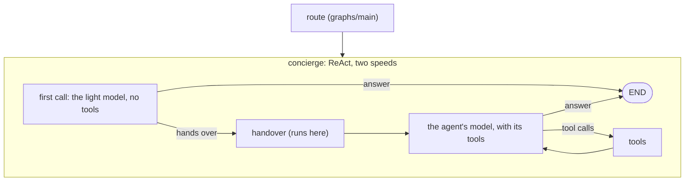

# Voice Graph

`graphs/voice` is [graphs/main](../main/README.md) with one change: on a live
voice turn, the ReAct step's **first model call runs on a light model**.
The light model speaks first -- in about a second, where the agent's own model
takes several -- then either answers, or hands the turn to the agent's own
model with a one-line opener the user hears while the real work runs.

It's **off** by default (`VOICE_LIGHT_MODEL=off`): every voice turn runs on
graphs/main. `VOICE_LIGHT_MODEL=FLASH_LITE:minimal` (any `TIER:LEVEL`) turns
it on.

## When it's built

[`GraphBuilder.build_graph`](../../core/runtime/graph_builder.py) builds this
graph instead of graphs/main when
[`light_call(ctx, config)`](../../core/runtime/graph_builder.py) names a light
model: a live voice turn of the agent you're talking to -- the room's agent,
or one the router handed the turn to -- on graphs/main and Gemini, with
`VOICE_LIGHT_MODEL` set. Never for a typed or scheduled turn, a stateless
agent or context, an agent another agent called (`called_by_agent`), or a
graph step. [`Agent._get_graph`](../../core/runtime/agent.py) caches it apart
from the agent's other graphs.

`graph.json` says `"subgraph": false`: like graphs/main it's an agent's own
graph, so no agent is offered it, `graph_status` skips it and `graph_call`
refuses it ([`GraphsLoader.is_subgraph`](../../core/loaders/graphs_loader.py)).

## A turn

1. **The light call.** The turn's first call (the user's words are the last
   message) goes to the light model: the agent's whole prompt and history, no
   tools bound, the light model's own thinking level, and the light call's
   rules after the system blocks ([prompts/light_call.md](prompts/light_call.md)).
   It begins with `<speech>`. When the conversation already holds the answer
   -- a follow-up, small talk, a clarifying question -- it answers, and the
   turn ends on that one call.
2. **The hand-over.** Otherwise it says in one sentence what the agent will
   do and ends with `<handover depth="low"/>` (minimal, low or medium).
   [`LightChatModel`](../../core/runtime/model/handover.py) takes the marker
   out as the reply streams -- nothing hears or shows it -- and puts a
   `handover` tool call on the reply in its place: FLASH and FLASH_LITE refuse
   a request that ends on the model's own turn, so the agent's model has to
   start after a function response.
3. **The `handover` tool** runs here, never in a model: it gives the depth to
   the agent's next call (`pick_thinking`, capped at medium on voice), tells
   the voice block the user heard the opener (`OPENER_HINT`, so the agent's
   model isn't asked for a sentence before its tool calls), logs
   `[Handover] agent=… depth=… applied=…` and puts a `handover` event on the
   voice trace. Its result tells the agent's model not to say the line again.
4. **The agent's model** makes every later call of the turn, with its tools,
   as on graphs/main. `handover` is never declared to it: Gemini accepts the
   call and its result in history without it (FLASH and PRO, later turns too).

The trace marks the light call's `model_call` event `light`, so the voice dry
run holds it to the light model (`scripts/voice_dryrun.py --light`).

## Files

| File | What |
| --- | --- |
| [graph.py](graph.py) | `create_graph`: graphs/main's, with the two-speed model and the `handover` tool |
| [graph.json](graph.json) | The graph's config: `"subgraph": false`, no tools or skills of its own |
| [prompts/light_call.md](prompts/light_call.md) | The light call's rules, on that call only; [light_call_prompt.py](prompts/light_call_prompt.py) renders them |
| [core/runtime/model/handover.py](../../core/runtime/model/handover.py) | The marker, and the light call's model |

Tests: [tests/graphs/voice/test_voice_graph.py](../../tests/graphs/voice/test_voice_graph.py) (whole turns on
scripted model streams), [tests/core/runtime/model/test_handover.py](../../tests/core/runtime/model/test_handover.py)
(the marker), and `TestLightCall` in [tests/core/runtime/test_graph_builder.py](../../tests/core/runtime/test_graph_builder.py)
(which turns get it).
