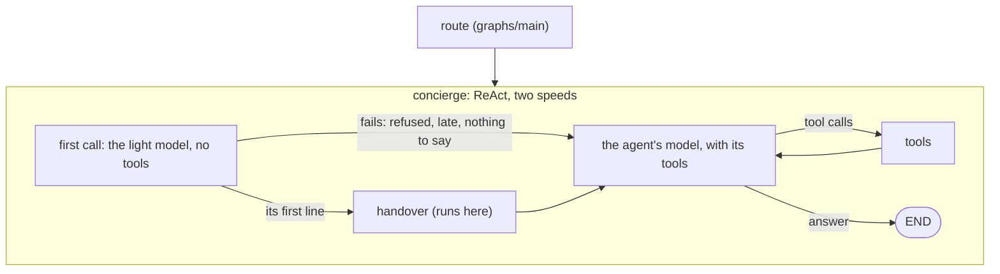

# Voice Graph

`graphs/voice` is [graphs/main](../main/README.md) with one change: on a live
voice turn, the ReAct step's **first model call runs on a light model**.
The light model only says the first line -- in about a second, where the
agent's own model takes several -- then always hands the turn to the agent's
own model, which gives the answer while the user hears that line.

It's **on** by default, on FLASH_LITE at minimal thinking (`VOICE_LIGHT_MODEL`,
any `TIER:LEVEL`). `VOICE_LIGHT_MODEL=off` runs every voice turn on graphs/main.

## When it's built

[`GraphBuilder.build_graph`](../../core/runtime/graph_builder.py) builds this
graph instead of graphs/main when
[`light_call(ctx, config)`](../../core/runtime/graph_builder.py) names a light
model: a live voice turn of the agent you're talking to -- the room's agent,
or one the router handed the turn to -- on graphs/main and Gemini, with
`VOICE_LIGHT_MODEL` set. Never for a typed or scheduled turn, a stateless
agent or context, an agent another agent called (`called_by_agent`), or a
graph step. [`Agent._get_graph`](../../core/runtime/agent.py) caches it apart
from the agent's other graphs.

`graph.json` says `"subgraph": false`: like graphs/main it's an agent's own
graph, so no agent is offered it, `graph_status` skips it and `graph_call`
refuses it ([`GraphsLoader.is_subgraph`](../../core/loaders/graphs_loader.py)).

## A turn

1. **The light call.** The turn's first call (the user's words are the last
   message) goes to the light model: the agent's whole prompt and history, no
   tools bound, the light model's own thinking level, and the light call's
   rules after the system blocks ([prompts/light_call.md](prompts/light_call.md)).
   It says one short sentence in a `<speech>` block, the start of the agent's
   reply ("Let me check the downstairs lights."), and never answers.
2. **The hand-over.** [`LightChatModel`](../../core/runtime/model/handover.py)
   passes on only that block and ends the call once it closes, dropping
   anything the light model wrote after it. Then it puts a `handover` tool call
   on the reply: FLASH and FLASH_LITE refuse a request that ends on the
   model's own turn, so the agent's model has to start after a function
   response. Every turn hands over.
3. **The `handover` tool** runs here, never in a model. It tells the voice
   block the user heard the first line (`OPENER_HINT`, so the agent's model
   isn't asked for a sentence before its tool calls), drops any
   `<next_thinking>` pick the light call wrote, so the agent's model thinks at
   its usual level, logs `[Handover] agent=…` and puts a `handover` event on
   the voice trace. Its result tells the agent's model not to say the line
   again.
4. **The agent's model** makes every later call of the turn, with its tools,
   as on graphs/main, and gives the answer. `handover` is never declared to
   it: Gemini accepts the call and its result in history without it (FLASH
   and PRO, later turns too).

**When the light call fails**, the turn doesn't wait for it. It gets one
attempt, no retries, and 1.5 s for its first chunk (`DEADLINE_S`). Refused
(429, 503), erroring, late, or ending without words in a `<speech>` block,
it raises `LightCallFailed` before anything was said: it's logged
(`[LightCall] fell back to the agent's model: …`) and put on the trace as
`light_fallback`, with the reason, and the agent's model makes the call
instead (`with_fallbacks`), as if there were no light call. One that breaks off
after its words began hands over with what was said, its block closed
(`light_cut`).

The trace marks the light call's `model_call` event `light`, so the voice dry
run holds it to the light model (`scripts/voice_dryrun.py --light`), and
`scripts/compare_token_stats.py --voice` counts the hand-overs and fallbacks.

## Files

| File | What |
| --- | --- |
| [graph.py](graph.py) | `create_graph`: graphs/main's, with the two-speed model, its fallback and the `handover` tool |
| [graph.json](graph.json) | The graph's config: `"subgraph": false`, no tools or skills of its own |
| [prompts/light_call.md](prompts/light_call.md) | The light call's rules, on that call only; [light_call_prompt.py](prompts/light_call_prompt.py) renders them |
| [prompts/handed_over.md](prompts/handed_over.md) | The `handover` call's result, what the agent's model reads; [handed_over_prompt.py](prompts/handed_over_prompt.py) renders it |
| [core/runtime/model/handover.py](../../core/runtime/model/handover.py) | The light call's model: its first line only, the `handover` call, and failing fast |

Tests: [tests/graphs/voice/test_voice_graph.py](../../tests/graphs/voice/test_voice_graph.py) (whole turns on
scripted model streams), [tests/core/runtime/model/test_handover.py](../../tests/core/runtime/model/test_handover.py)
(the light call's model), and `TestLightCall` in [tests/core/runtime/test_graph_builder.py](../../tests/core/runtime/test_graph_builder.py)
(which turns get it).
